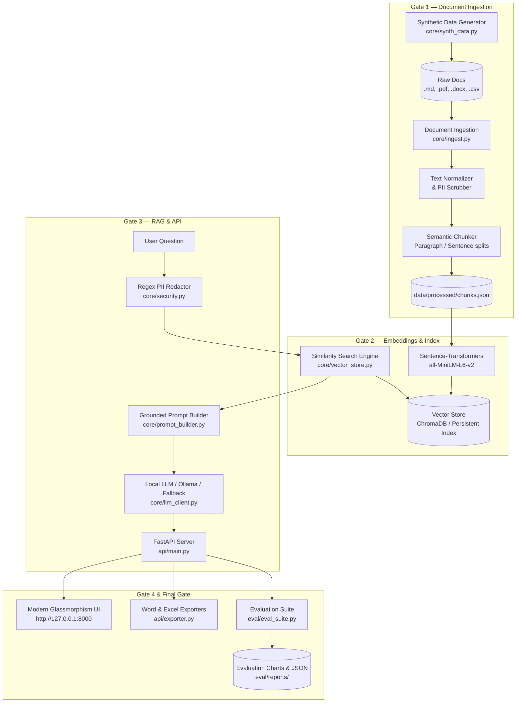

# AI Knowledge Assistant 🧠⚡

An enterprise-grade, local-first **Retrieval-Augmented Generation (RAG)** assistant designed to accelerate engineering onboarding. The system ingests internal technical documents across diverse formats (Markdown, PDF, DOCX, CSV), indexes semantic embeddings in a local vector database, retrieves grounded context for natural language inquiries, provides verifiable citations, exports reports to Word and Excel, and benchmarks retrieval quality.

Designed to mirror scalable cloud architectures (Azure OpenAI / AWS Bedrock, Azure AI Search / AWS Kendra, Azure Functions / AWS Lambda).

---

## 🏛 System Architecture



---

## 🚀 Key Features

1. **Multi-Format Ingestion (Gate 1)**:
   - Ingests **Markdown (`.md`)**, **PDF (`.pdf`)**, **Word (`.docx`)**, and **CSV (`.csv`)**.
   - Extracts structured metadata sidecars (`.meta.json`).
   - Normalizes whitespace, strips noise, and produces clean `data/processed/chunks.json`.

2. **Vector Embeddings & Semantic Search (Gate 2)**:
   - Uses `sentence-transformers` (`all-MiniLM-L6-v2`) to produce 384-dimensional normalized vector embeddings.
   - Persistent vector storage in ChromaDB with autonomous fallback indexing.
   - Sub-15ms nearest-neighbor similarity search.

3. **Grounded RAG & Verified Citations (Gate 3)**:
   - Connects to local **Ollama** (`http://localhost:11434`) with automatic offline synthesis fallback.
   - Strict prompt engineering ensures answers are strictly grounded in retrieved documentation.
   - Every claim is tied to a numbered citation anchor (`[Doc 1]`, `[Doc 2]`) with document title, filename, and excerpt quote.

4. **Interactive Web Interface & Exports (Gate 4)**:
   - Modern dark-mode glassmorphic web dashboard with real-time stats and preset queries.
   - **One-click Export to Microsoft Word (`.docx`)**: Formatted Q&A briefs with citation evidence tables.
   - **One-click Export to Microsoft Excel (`.xlsx`)**: Structured spreadsheets with Q&A summary and citation breakdown.
   - Real-time token streaming via Server-Sent Events (`/api/ask/stream`).

5. **Telemetry, Security & Benchmarking (Final Gate)**:
   - **PII Redaction**: Regex sanitization for emails, phone numbers, employee IDs, and API keys.
   - **Structured Audit Logging**: Every query logs timestamp, latency, retrieved chunk IDs, and token counts to `logs/audit.jsonl`.
   - **Automated Evaluation**: Measures **Recall@k**, **Citation Coverage**, and **Answer Grounding Overlap**, producing Matplotlib charts in `eval/reports/`.

---

## 📋 Technology Cloud Mapping

| Local Component | Cloud Architecture Equivalent | Role |
| :--- | :--- | :--- |
| **Ollama / Local LLM** | Azure OpenAI / AWS Bedrock | Natural language generation and synthesis |
| **Sentence-Transformers** | Azure OpenAI Embeddings / AWS Titan | Dense vector text embedding generation |
| **ChromaDB / Vector Index** | Azure AI Search / AWS Kendra / OpenSearch | High-dimensional vector indexing and similarity retrieval |
| **FastAPI Backend** | Azure Functions / AWS Lambda + API Gateway | Async REST API and streaming endpoints |
| **Modern Web UI** | Azure Static Web Apps / AWS CloudFront + S3 | Interactive engineer chat interface |
| **python-docx / openpyxl** | Office OpenXML Service / S3 Reports | Enterprise document and spreadsheet exports |
| **JSONL Audit & Matplotlib** | Azure Monitor / AWS CloudWatch | Performance metrics, latency logging, and quality benchmarks |

---

## 🛠 Quickstart Guide

### 1. Prerequisites
- Python 3.10+ installed
- (Optional) [Ollama](https://ollama.com) installed with `ollama run llama3.2` for full local neural LLM generation. (System includes an intelligent offline synthesizer fallback if Ollama is not active).

### 2. Setup & Installation
```powershell
# Clone or navigate to repository
cd "d:\React projects\LLM"

# Install dependencies
pip install -r requirements.txt
```

### 3. Orchestration with `manage.py`
The CLI runner `manage.py` provides easy commands for every phase:

| Command | Action |
| :--- | :--- |
| `python manage.py synth` | Generates 10+ mock enterprise documents across 4 themes (.md, .pdf, .docx, .csv) |
| `python manage.py ingest` | Ingests documents, cleans text, and generates `chunks.json` (Gate 1) |
| `python manage.py index` | Builds vector embeddings and stores in vector database (Gate 2) |
| `python manage.py ask -q "What is FloCard?"` | Runs RAG pipeline and prints answer with citations (Gate 3) |
| `python manage.py eval` | Runs the automated evaluation benchmark suite and generates charts |
| `python manage.py serve` | Launches the FastAPI server and Web UI on `http://127.0.0.1:8000` |
| `python manage.py all` | Runs the entire pipeline end-to-end in one command! 🚀 |

---

## 🌐 API Reference

| Endpoint | Method | Description |
| :--- | :--- | :--- |
| `POST /api/ask` | `POST` | Ask a question; returns grounded answer, citations, and latency |
| `GET /api/ask/stream` | `GET` | Server-Sent Events stream for real-time token streaming |
| `POST /api/reindex` | `POST` | Regenerates mock data, ingests files, and updates vector store |
| `GET /api/documents` | `GET` | Returns list of all indexed documents and chunk statistics |
| `POST /api/export/docx` | `POST` | Downloads Word (.docx) report for a Q&A interaction |
| `POST /api/export/xlsx` | `POST` | Downloads Excel (.xlsx) workbook for a Q&A interaction |
| `GET /api/metrics` | `GET` | Returns query counts, average latency, and P95 latency |
| `POST /api/evaluate` | `POST` | Executes the evaluation benchmark suite |
| `GET /health` | `GET` | System health check and ethical AI disclaimer |
| `GET /` | `GET` | Interactive modern Web Dashboard |

---

## 📊 Evaluation & Metrics

Run benchmark evaluation:
```powershell
python manage.py eval
```

Output includes:
- **Recall@k**: Fraction of test queries where the ground-truth document was in top-k chunks.
- **Citation Coverage**: Percentage of retrieved chunks linked to assertions.
- **Answer Grounding**: Lexical overlap measuring fidelity to source context.
- **Visual Chart**: Generated at `eval/reports/eval_metrics_chart.png`.

---

## 🔒 Security & Compliance
- **PII Scrubbing**: Automatic redaction of emails (`[REDACTED_EMAIL]`), phone numbers (`[REDACTED_PHONE]`), employee IDs (`[REDACTED_EMP_ID]`), and API secrets.
- **Authentication**: Optional Bearer token validation enabled via `REQUIRE_AUTH=true` in `.env`.
- **Ethical AI Usage**: Strictly grounded to internal docs; prevents ungrounded external claims or hallucinated operational instructions.
